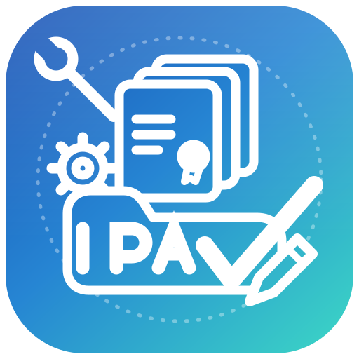

<a href="https://techperson1234.github.io/IPA-SIGNER-WEN/">
  
  
  <div id="user-content-toc">
    <ul style="list-style: none;">
      <summary>
        <h1>nexus-signer</h1>
      </summary>
    </ul>
  </div>
</a>

---

Install SideStore (or other apps) and import your pairing file with ease

**This repository and [https://techperson1234.github.io/IPA-SIGNER-WEN/](https://techperson1234.github.io/IPA-SIGNER-WEN/) are the official ways to download nexus-signer. Do not download from any other sources or websites.**

## How to use

- Install usbmuxd for your platform
  - Windows: [iTunes](https://apple.co/ms)
  - macOS: Included
  - Linux: Potentially included, if not, install via your package manager
- Install the latest version for your platform from the [releases](https://techperson1234.github.io/IPA-SIGNER-WEN/)
- Plug in your iDevice to your computer
- Open the app
- Sign into your Apple ID
- Select your action (e.g. install SideStore)

## Features

- Install SideStore, LiveContainer + SideStore or LiveContainer, import certificate and place rppairing+lockdown pairing files automatically
- Import any IPA
- Intelligent error suggestions to help resolve common issues
- Manage pairing files in apps like StikDebug, SideStore, Protokolle, etc
- See and revoke development certificates & app ids

## Troubleshooting

- If you are unable to solve an issue on your own, copy the full error message and ask on the [idevice Discord server](https://discord.gg/EA6yVgydBz) or [open an issue](https://techperson1234.github.io/IPA-SIGNER-WEN/).
- You can view app logs with the "View Logs." If nothing is showing up, change the log level to "Debug."
- If those logs aren't helpful, logs with additional are stored in the following locations:
  - Windows: `%APPDATA%\com.nexussigner.app\logs`
  - macOS: `~/Library/Application Support/com.nexussigner.app/logs`
  - Linux: `~/.local/share/com.nexussigner.app/logs/`

## Translating

nexus-signer needs localization! If you speak another language and notice nexus-signer does not support it or has mistakes, please consider contributing.

To update/edit an existing language, make a PR modifying `src/locales/<lang>.json`.

To add a new language, add your language to `src/i18next.ts`, and in `src/locales` copy `en.json` to a new file titled `<langcode>.json` and update the strings.

**i18next.ts:**

```ts
const languages = [
  ["en", "English"],
  ["es", "Español"],
  // Your language here...
] as const;
```

You can also add your name to the translators section of the README.

Thank you for translating!

## Building from source

1. Install [bun](https://bun.sh) (or [Node.js](https://nodejs.org)) and [Rust](https://www.rust-lang.org/tools/install)
2. Clone the repository and `cd` into it
3. Run `bun i` (or `npm i`)

For development with hot reload: `bun tauri dev` (or `npm run tauri dev`)
Make a production build: `bun tauri build` (or `npm run tauri build`)

## Credits

- Icon made by [Transistor](https://github.com/transistor-exe)
- UI improved by [StephenDev0](https://github.com/StephenDev0)
- [idevice](https://github.com/jkcoxson/idevice) by [jkcoxson](https://github.com/jkcoxson) for communicating with iOS devices
- [isideload](https://github.com/nab138/isideload) for installing apps
  - [idevice](https://github.com/jkcoxson/idevice) by [jkcoxson](https://github.com/jkcoxson) crate is used to communicate with the device
  - [apple-codesign-quick](https://github.com/Dadoum/apple-codesign-quick) by [Dadoum](https://github.com/Dadoum) for codesigning and entitlements
  - [Impactor](https://github.com/claration/Impactor) by [claration](https://github.com/claration) was used as a reference for cryptography operations (converting certs to p12, etc.).
  - [Sideloader](https://github.com/Dadoum/Sideloader) by [Dadoum](https://github.com/Dadoum) was used as a reference for how apple private developer endpoints work
- [idevice_pair](https://github.com/jkcoxson/idevice_pair) was used as a reference for pairing file management
- App made with [tauri](https://tauri.app)

## Translators

Thank you to everyone who has contributed translations! See the [Translating](#translating) section if you would like to contribute as well.

- [By3lish](https://github.com/by3lish): Azerbaijani (az)
- [TNT-333](https://github.com/TNT-333): German (de)
- [basketshoe](https://github.com/basketshoe): Italian (it)
- [baocreata](https://github.com/baocreata): Vietnamese (vt)
- [IamArayel](https://github.com/IamArayel): French (fr)
- [kkula9999](https://github.com/kkula9999): Traditional & Simplified Chinese (zh_tw & zh_cn)
- [sibwaze](https://github.com/sibwaze): Russian (ru)
- [notmalicik](https://github.com/notmalicik): Română (ro)
- [mirdukkkkk](https://github.com/mirdukkkkk): Improved Russian (ru)
- [okinaau](https://github.com/okinaau): Arabic (ar)
- [ChouChiu](https://github.com/ChouChiu): Cantonese (zh_hk) & Improved Chinese (zh_tw & zh_cn)
- [marcinmajsc](https://github.com/marcinmajsc): Polish (pl)
- [ern775](https://github.com/ern775): Turkish (tr)
- [canpng](https://github.com/canpng): Improved Turkish (tr)
- [jazoppix](https://github.com/jazoppix): Spanish (es)
- [eseiker](https://github.com/eseiker): Korean (ko)
- [seomin0610](https://github.com/seomin0610): Improved Korean (ko)
- [Ordyan777](https://github.com/Ordyan777): Armenian (am)
- [kakik0u](https://github.com/kakik0u): Japanese (ja)
- [lkspodmol](https://github.com/lkspodmol): Czech (cs_cz)
- [marcusherelammonstyle-cmd](https://github.com/marcusherelammonstyle-cmd): Swedish (sv)
- [MCI49312](https://github.com/MCI49312): Hungarian (hu)
- [Kynonim](https://github.com/Kynonim): Indonesian (id)
- [DD00031](https://github.com/DD00031): Dutch (nl)
- [Toritan123](https://github.com/Toritan123): Improved Japanese (ja)
- [marcinmajsc](https://github.com/marcinmajsc): Improved Polish (pl)
- [dleiferives](https://github.com/dleiferives): Greek (el)
- [ShadowWLX](https://github.com/ShadowWLX): Improved French (fr)
- [fkpcomposer](https://github.com/fkpcomposer): Brazilian Portuguese (pt_br)
- [474FrediFred](https://github.com/474FrediFred): Swiss German (de_ch)
- [bovae](https://github.com/bovae) & [b1twalker](https://github.com/b1twalker): Ukranian (uk)

## License

Copyright (C) 2026 nab138

The source code of this repository is licensed under the MIT License. See the [LICENSE](/LICENSE) file for the full text.

## Contributing

Please read our [Contributing](/CONTRIBUTING.md) policy before making a contribution.
